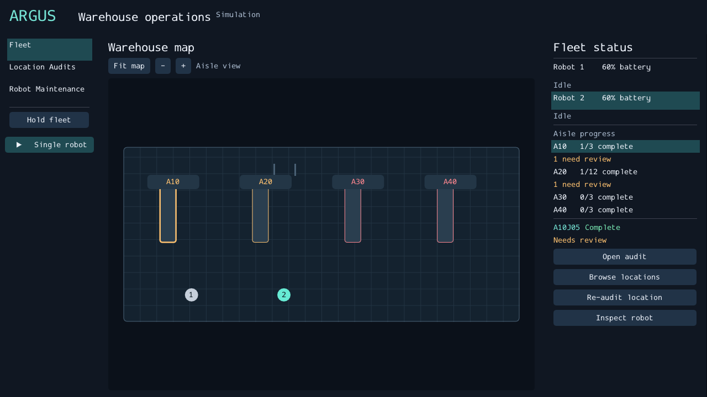
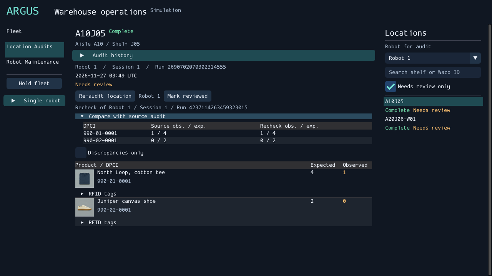
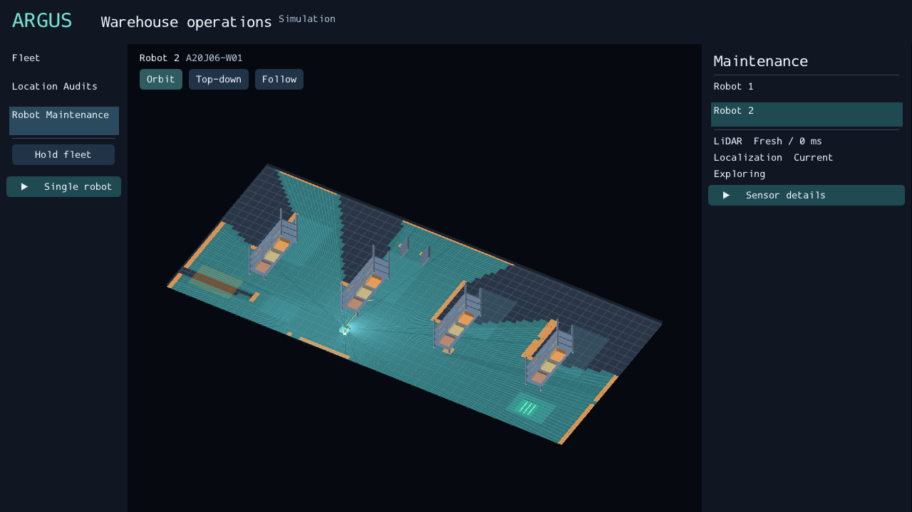

# ARGUS

ARGUS is an offline C++20 simulator for autonomous retail stockroom mapping and RFID inventory audits. The Windows operations center shows where two simulated robots are working, which inventory locations are complete, and what each audit found.



The built-in stockroom has four aisles and 21 auditable locations. Whole shelves use IDs such as `A10J05`. A shelf split into smaller bins, called Wacos, uses IDs such as `A20J06-W01` for individual bins. Robots can audit separate routes concurrently and yield when aisle access overlaps.

## Quick start

The portable desktop preview targets **Windows 11 x64** with an interactive OpenGL-capable graphics driver. Use a window of at least 1280 × 720 for the documented workflow. The ZIP includes its app-local runtime. Keep the bundled DLLs beside the executables.

1. Obtain the Windows x64 ZIP and its SHA-256 from the same trusted release channel.
2. Verify the ZIP with `Get-FileHash -Algorithm SHA256 .\ARGUS-0.1.0-windows-x64.zip` and compare the result with the expected digest.
3. Extract the ZIP to a new folder. From that folder, run the following in PowerShell to keep audit history between sessions.

```powershell
$data = Join-Path $env:LOCALAPPDATA 'ARGUS'
New-Item -ItemType Directory -Force $data | Out-Null
.\bin\argus-desktop.exe --operations-data $data
```

Launching `argus-desktop.exe` without a data directory starts a temporary session. For updates, close ARGUS, back up the data directory, and extract the new program to a separate folder. Launch it with the same data directory. To remove the portable app, close it and delete the extracted program folder. The data directory remains available. The current preview binaries are unsigned. [Installation, storage, and troubleshooting](docs/release/onboarding.md)

## Run your first audit

1. In **Fleet**, select Robot 1 and open shelf `A10J05`. Choose **Start location audit**. For a second job, select Robot 2 and open `A20J06-W01`.
2. As a robot moves, open **Robot Maintenance** to inspect its LiDAR rays, motion trail, scan age, and localization status. **Hold fleet** interrupts work. If a held robot retains aisle access, select **Return to berth** to clear it.
3. Once an audit is complete, choose **Open audit** or use **Location Audits** to search by location ID. Review the product photo, name, DPCI, and expected and observed quantities. Expand the RFID evidence when you need individual tag details.
4. For a report that needs review, choose **Mark reviewed** after checking the discrepancies. Choose **Re-audit location** with an available robot to collect new evidence. The new report links to its source for a side-by-side comparison.
5. With durable storage enabled, restart ARGUS using the same data directory and reopen the report from **Location Audits**.

## Location Audits

A completed report shows the products expected or observed at the location. Unidentified tags and reads that could not be attributed to the location are listed separately. Audit history retains previous results and review timestamps.



## Robot Maintenance

The maintenance view keeps full-brightness LiDAR rays and the motion trail visible alongside the selected robot's scan age, localization, and navigation status.



### Keyboard shortcuts

| Shortcut | Action |
| --- | --- |
| `Ctrl+F` | Open location search. Type a full shelf or Waco ID and press Enter. |
| `F6` / `F7` / `F8` | Open Fleet, Location Audits, or Robot Maintenance. |
| `F9` / `F10` | Focus Mark reviewed or Re-audit location when available. Check the focused button and press Space to activate it. |
| `Escape` during a search edit | Leave the active text edit. |

## Headless tools

The headless tools run without a graphical desktop. From the extracted ZIP's root, run these examples in Command Prompt:

```bat
bin\argus-headless.exe --warehouse small-backroom --sensor-steps 220
bin\argus-headless.exe --warehouse small-backroom --explore-steps 1200
bin\argus-headless.exe --warehouse small-backroom --export-map 80 > backroom.argmap
bin\argus-headless.exe --warehouse small-backroom --map-stdin < backroom.argmap
```

Built-in scenarios include `small-backroom`, `cluttered-receiving`, `broad-stockroom`, and `rfid-audit`. Use `--help` for available options. The inventory CLI supports catalog imports, DPCI lookup, and RFID audit exports. The mission CLI supports queued work, checkpoints, and recovery.

## Build from source

Use Git, CMake 3.25 or later, Ninja, and the vcpkg revision pinned by [`vcpkg.json`](vcpkg.json). After cloning vcpkg, confirm its commit matches `builtin-baseline` before bootstrapping. Dependency sources are downloaded during configuration.

### Windows

Install Visual Studio 2022 with the Desktop development with C++ workload and a Windows SDK. From an x64 Native Tools Command Prompt at the repository root:

```bat
git clone --branch 2026.10.16 --single-branch https://github.com/microsoft/vcpkg.git "%LOCALAPPDATA%\argus-vcpkg"
set "VCPKG_ROOT=%LOCALAPPDATA%\argus-vcpkg"
git -C "%VCPKG_ROOT%" rev-parse HEAD
```

```bat
call "%VCPKG_ROOT%\bootstrap-vcpkg.bat" -disableMetrics
set "VCPKG_DISABLE_METRICS=1"
cmake --workflow --preset windows-debug
cmake --workflow --preset windows-release
out\build\windows-debug\argus-desktop.exe
```

### Linux

On Ubuntu 24.04 x64, the Linux preset builds and tests the headless targets with Clang sanitizers and static analysis. On WSL, prefer a checkout on the Linux filesystem.

```sh
sudo apt-get update
sudo apt-get install -y git build-essential cmake ninja-build curl zip unzip tar pkg-config clang-18 clang-tidy-18 clang-format-18 libclang-rt-18-dev
git clone --branch 2026.10.16 --single-branch https://github.com/microsoft/vcpkg.git "$HOME/argus-vcpkg"
export VCPKG_ROOT="$HOME/argus-vcpkg"
git -C "$VCPKG_ROOT" rev-parse HEAD
```

```sh
"$VCPKG_ROOT/bootstrap-vcpkg.sh" -disableMetrics
export VCPKG_DISABLE_METRICS=1
git ls-files -z -- '*.cpp' '*.hpp' '*.hpp.in' | xargs -0 -r clang-format-18 --dry-run --Werror
cmake --workflow --preset linux-ci
./out/build/linux-ci/argus-headless --warehouse small-backroom --sensor-steps 220
```

## Architecture and verification

The simulator generates seeded odometry, LiDAR, and RFID observations. Operational navigation and audits consume those observations and estimates. Exact simulated positions and placements are isolated in simulation and explicit diagnostic or evaluation paths. A shared clock synchronizes fleet motion, while SQLite stores audit records, review timestamps, and re-audit links.

The Windows release checks cover audit history across package replacement and keyboard operation through a simulated display-scale change. The portable ZIP includes build and test evidence under `verification/`. Clean-machine Windows acceptance and physical monitor DPI transitions remain open.

ARGUS uses fictional inventory and probabilistic RFID simulation. Its readings are uncalibrated, and its motion and hold behavior apply within the simulated warehouse. [Distribution notice](NOTICE.md)
