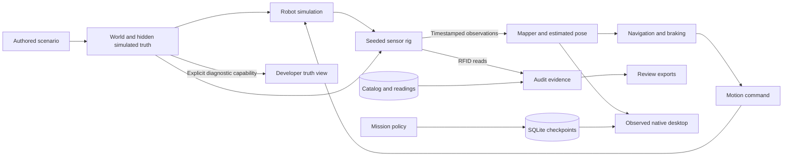

# ARGUS architecture and extension points

The live engine owns the foreground run. The workbench owns its connections and a separate background simulator for audits and missions. Its bounded mailbox passes commands and completed snapshots to the UI. The repository API keeps writes transactional. Operational navigation and audit consume estimates or observations. The renderer shows authored geometry and observed results. Hidden poses and placements remain inside simulation and explicit diagnostic or evaluator paths.

| Interface | Contract |
| --- | --- |
| `simulation::Warehouse`, `RobotSimulation`, `SensorRig` | Load bounded authored JSON, step at 50 ms, and capture seeded observations. |
| `mapping::Mapper`, `mapping::Grid` | Ingest sequenced observations. Publish an estimated occupancy grid and explicit uncertainty. |
| `navigation::Navigator` | Consume a map, estimate, and fresh scan. Produce motion commands with braking and return states. |
| `inventory::Repository` | Validate typed catalog records, page queries, and append RFID evidence transactionally. |
| `audit::Evidence`, `audit::write_report` | Aggregate unique fictional EPCs and produce bounded JSON/CSV for review. |
| `mission::Store` | Own a connection, checkpoint by revisioned lease, and enforce the mission transition matrix. |

API contracts live under the corresponding subdirectories in `include/argus`. The build and verification presets are in the root `CMakePresets.json`. Use the [engineering decisions](../decisions), [workspace review checklist](../review-checklist.md), and [Phase 11 benchmark and security evidence](../testing/phase-11.md).

## Assumptions and roadmap

The robot uses planar differential-drive kinematics, biased wheel odometry and a 2D occupancy grid. The occupancy estimate has no automatic loop closure. LiDAR and RFID are scripted sensor models with seeded variation, finite cadence and queue limits. RFID scores rank candidates and require review. Asset and mission data are fictional. Safety controls implement the simulation's assumptions only.

Future priorities include richer scenario authoring, uncertainty calibration, audit-review persistence and a separately validated distribution channel. Physical robot operation and retailer integrations require independent design, authorization, and validation.
