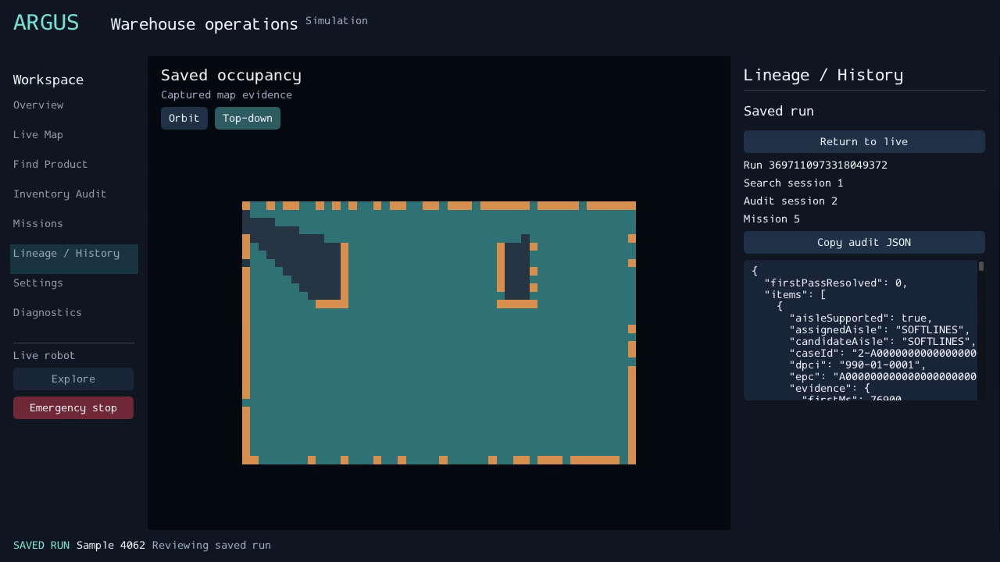

# ARGUS 0.1.0 Windows x64 preview

ARGUS is an offline C++20 simulator for retail stockroom mapping and probabilistic RFID audits. One simulated robot can explore, investigate a product, audit an aisle and run routed missions. The operator can review the observed map and save it alongside the audit for a later session.

**Download** `ARGUS-0.1.0-windows-x64.zip` and its SHA-256 sidecar from the same verified release. The ZIP contains the program, app-local runtime, fictional scenarios, notices, build provenance, and passing build tests. The Windows application binaries are unsigned.

**Target environment** Windows 11 x64 with an interactive OpenGL-capable desktop. CLI workflows can run without graphics. The verification report identifies the tested machine and open fresh-machine gate.

**Media** The showcase assets are `ARGUS-0.1.0-operations-center.png` and `ARGUS-0.1.0-workflow-tour.mp4`. The clip shows the scripted native workflow at an accelerated pace. The walkthrough below is for a live presentation. [Native recording and tour commands](../operations-center.md#local-verification-and-recording)

## Changes and verification

The simulation has no real-world safety certification. RFID is probabilistic and uncalibrated. The preview uses fictional data and runs offline. [Changelog](../../CHANGELOG.md) · [Installation and tutorial](onboarding.md) · [Performance measurements](../testing/phase-15.md) · [Distribution notice](NOTICE.md)

## Two-minute demonstration

| Time | Show |
| --- | --- |
| 0:00–0:15 | Open the verified portable copy with a data directory. Drive in the fictional stockroom and switch to Live Map. |
| 0:15–0:40 | Start Explore. Toggle **Simulate LiDAR dropout** and show the scan ageing, the map staying visible and the robot holding. Clear the toggle and show recovery. |
| 0:40–1:00 | Investigate fictional DPCI `990-01-0001`. Show the route and RFID evidence as the same robot moves. |
| 1:00–1:25 | Run the `SOFTLINES` audit. Compare expected stock with unique attributed EPCs, then show a routed mission or return to dock. |
| 1:25–1:50 | Save the map and audit. Relaunch against the same data directory, open the saved run and show its audit JSON and run identity. |
| 1:50–2:00 | Show the package checksum and test receipt. State the simulation and RFID limits. |
