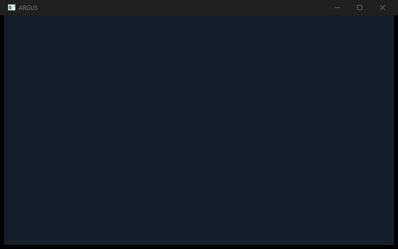

# Phase 1 engineering foundation verification

**Date** November 23, 2026

**Build and test revision** `72ff519`

**Status** Implementation committed. Local verification passed. Hosted GitHub Actions execution awaits a pull request or a push to `main`.

## Delivered

- C++20 core with typed identifiers, distance, time and velocity, explicit results, and independently owned seeded RNG state.
- Native SDL3/OpenGL Windows shell and portable headless executable. Both share bounded command-line parsing, generated version metadata, and structured startup and error logs.
- CMake/Ninja workflows, a pinned vcpkg baseline, GoogleTest, formatting and static checks, Linux ASan/UBSan, and read-only GitHub Actions with trusted cache publication.
- The engineering contract, requirements, review checklist, ADR, threat model, test strategy, build instructions and an example JSON scenario envelope.

## Verification

Windows ran on Windows 11 Pro x64, build 26200, with MSVC 19.40.33811, Windows SDK 10.0.22621.0 and CMake 3.28.3-msvc11. Linux ran on Ubuntu 24.04 x64 under WSL2 with Clang 18.1.3, CMake 3.28.3 and Ninja 1.11.1. Both used the vcpkg registry revision `9eec002df1cd109f8f104cd966a763daf9751489`, with SDL 3.4.18 on Windows, GoogleTest 1.18.0, spdlog 1.17.0#1 and transitive fmt 12.2.0#1.

| Check | Result |
| --- | --- |
| `cmake --workflow --preset windows-debug` | Fresh Windows clone built the desktop shell and headless executable. **9/9** CTest tests passed. |
| `cmake --workflow --preset windows-release` | The same fresh Windows clone built both release binaries. **9/9** tests passed. |
| `cmake --workflow --preset linux-ci` | Fresh clone on the Linux filesystem built the headless targets with clang-tidy, ASan, UBSan and leak detection. **8/8** tests passed with no sanitizer findings. |
| Golden RNG and invalid configuration | Both platforms reproduced the five-sample MT19937 sequence for seed 5489. Tests verified independent state, rejected malformed and out-of-range input, and checked process exit codes and log fields. |
| Native Windows shell | The Release binary created an OpenGL window. A Win32 smoke check resized it to 800 × 500 and observed a successful render. Separate launches exited with status 0 on close and on Escape. An unsupported video driver exited with status 1 and a structured error in CTest. |
| Windows binary hardening | `dumpbin /headers /loadconfig` confirmed Control Flow Guard, Dynamic Base and NX compatibility in both Release executables. |
| Windows static analysis | MSVC `/analyze` built the desktop target and its project libraries without findings after excluding external headers. |
| Link dependency graph | Generated CMake Graphviz output with vcpkg's post-build DLL copying disabled for inspection. The two apps and test target depend on the startup library, which depends on the core. No project library cycle appeared. |
| Formatting and workflow lint | C++ sources passed `clang-format-18 --dry-run --Werror`. The workflow passed `actionlint -no-color .github/workflows/phase-checks.yml` with actionlint 1.7.11. |
| Scenario envelope | Python jsonschema 4.10.3 validated the schema and example against Draft 2020-12. It rejected six fixtures covering missing fields, extra fields, wrong version and invalid bounds. |

The fresh clones used `git clone --no-local --single-branch --branch codex/phase-01-engineering-foundation <local-repo> <fresh-dir>`. Clean source trees restored ABI-matched vcpkg binaries after the initial dependency build. Formatting used the exact tracked-file command in the README. For graph inspection the local command was `cmake -S . -B out/build/windows-debug -DVCPKG_APPLOCAL_DEPS=OFF --graphviz=phase-01-targets.dot`.

Windows native analysis commands in the verification clone:

```bat
cmake --preset windows-debug "-DCMAKE_CXX_FLAGS=/DWIN32 /D_WINDOWS /EHsc /analyze /analyze:external- /external:anglebrackets /external:W0"
cmake --build --preset windows-debug --target argus-desktop --parallel 2
```



## Failures and remaining verification

- The first SDL dependency build failed under MSVC with `C1356: unable to find mspdbcore.dll` while vcpkg was running 25 build workers. Retrying with `VCPKG_MAX_CONCURRENCY=4` passed. The pinned SDL port also reports an unused Unix CMake option on Windows. That warning did not affect the build or tests.
- Windows clang-tidy 17 stopped on SDL header pragmas. MSVC also flagged SDK and fmt headers on the first project-wide analysis. The MSVC project-only run passed with warnings treated as errors. Linux clang-tidy 18 passed on the headless targets.
- The GitHub Actions workflow is configured for pull requests and pushes to `main`. Local runs exercised all three presets. The branch was kept local, so a hosted workflow run remains an open acceptance gate.
- Linux sanitizers cover ARGUS headless code. SDL/OpenGL verification ran on Windows. The scenario envelope is an example for the next phase. Work stopped at the Phase 1 handoff.
