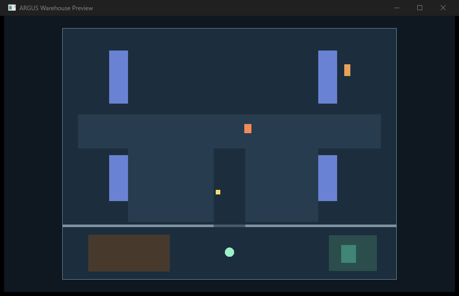

# Phase 2 warehouse digital twin verification

**Date** November 23, 2026

**Build and test revision** `acd6ebb`

The three bundled warehouses load in the Windows preview and headless runner. The local Phase 2 gates passed. Hosted GitHub Actions remains unverified on the local branch.

## Verification

| Check | Observed result |
| --- | --- |
| `cmake --workflow --preset windows-debug` | Built both executables with MSVC 19.40.33811 and passed **24/24** CTest tests. |
| `cmake --workflow --preset windows-release` | Built both executables with MSVC 19.40.33811 and passed **24/24** CTest tests. |
| `cmake --workflow --preset linux-ci` | Built with Clang 18.1.3 on Ubuntu 24.04 under WSL2. Passed **23/23** tests with clang-tidy, ASan, UBSan and leak detection. |
| Formatting and native static analysis | Tracked C++ files passed clang-format 18. Both Windows executables passed MSVC project-code analysis. |
| Scenario schema | Python jsonschema 4.10.3 validated the Draft 2020-12 schema and all three bundled files. It rejected an active window assigned to a non-temporary actor. |
| Collision and replay | Tests covered contact at walls and floor limits, door gaps, clear robot spawns, active obstruction lifetimes and 400 comparisons against unindexed collision checks. |
| Cross-platform determinism | Matched Windows Release and Linux headless snapshot text for all three fixtures at ticks 0, 19, 20, 179, 180 and 18446744073709551615. |
| Import and export | Every built-in export matched the authored SHA-256. Reimport produced the same tick-40 preview. Oversized, malformed, duplicate-key, invalid-geometry and invalid-reference cases were rejected. |
| Placement boundary | Tests confirmed the snapshot types have no placement fields. The headless preview omits EPCs and offsets. Simulation-side queries returned the expected tags only inside the query region. |
| Native preview | A Windows Release smoke check opened each built-in, resized the window to 900 × 580, and sampled rendered rack and moving worker pixels from separate frames. All three exited with status 0 through the close button or Escape. |

The pinned vcpkg baseline resolved nlohmann-json 3.12.0#2. The Windows and Linux workflows used CMake 3.28.3 on the same host. Windows native analysis ran in a separate build directory:

```bat
cmake --preset windows-debug -B out/build/windows-phase-02-analysis "-DCMAKE_CXX_FLAGS=/DWIN32 /D_WINDOWS /EHsc /analyze /analyze:external- /external:anglebrackets /external:W0"
cmake --build out/build/windows-phase-02-analysis --target argus-desktop argus-headless --parallel 3
```

For replay comparison, both executables ran `--warehouse NAME --tick UINT64`. The test compared the stdout JSON after platform line endings were normalized. The integration test checks a fixed reference too. At tick 40, the first small-backroom worker's southwest X coordinate is 4,960 mm.



## Failures and limits

No build or test failures appeared in the final verification runs. The Windows preview is a diagnostic 2D floor plan with a stationary robot spawn. Actor paths and outlines use conservative swept rectangles, which can rule out paths that would be time-separated. Phase 2 stops at world simulation, rendering data and sensor-query boundaries. Hosted GitHub Actions remains the open verification item carried forward from Phase 1.
