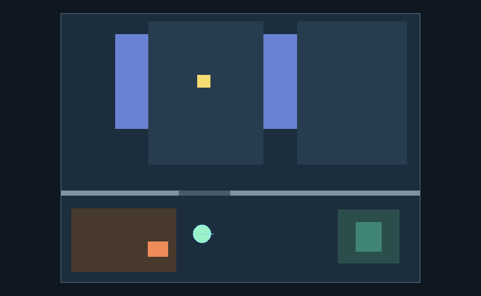

# Phase 3 robot locomotion and battery verification

**Date** November 23, 2026

**Build and test revision** `da5ff7a`

The Windows preview and headless runner share the same 50 ms robot simulator. The local Phase 3 gates passed. Hosted GitHub Actions remains an open verification item on the local branch.

## Verification

| Check | Observed result |
| --- | --- |
| `cmake --workflow --preset windows-debug` | Built the desktop and headless targets. **39/39** CTest tests passed with MSVC 19.40.33811. |
| `cmake --workflow --preset windows-release` | Built both Release executables. **39/39** CTest tests passed. |
| `cmake --workflow --preset linux-ci` | **38/38** tests passed on Ubuntu 24.04 x64 under WSL2 with Clang 18.1.3, clang-tidy, ASan, UBSan and leak detection. |
| Kinematics | Straight travel, in-place spin and a turn followed their analytical trajectories. Tests verified velocity clamps, acceleration, dead-man braking and distinct encoder odometry. |
| Collision safety | Sweeps detected a 1 mm wall and a translating obstacle between clear endpoint samples. A seeded run of 1,680 steps stayed outside walls and a shelf. A timed obstacle caused a world hold, which cleared when the robot reversed to a safe point. |
| Battery | Tests verified exact idle, sensor and drive costs, the low threshold, stopping at zero, rejected underpowered motion, charging from zero and the capacity cap. |
| Headless replay | The 220-step drive probe produced the same JSON on repeat runs and across Windows Release and Linux for all three layouts at start tick 8. The small-backroom run reported X at 13.648 m, measured speed at zero and collision blocked. Operational output included odometry and excluded true robot pose. |
| Desktop interaction | Native input moved the robot only with Space held, then stopped it on release. Minimize and restore disarmed stale keys. X latched the stop and blocked Home until R cleared the latch. Home reset to spawn, F3 toggled the labeled truth overlay, and Escape exited with status zero. |
| Formatting and static analysis | Tracked C++ passed clang-format 18. MSVC project-code analysis passed for the Windows targets without findings. |

The Windows static-analysis commands used a separate build directory:

```bat
cmake --preset windows-debug -B out/build/windows-phase-03-analysis "-DCMAKE_CXX_FLAGS=/DWIN32 /D_WINDOWS /EHsc /analyze /analyze:external- /external:anglebrackets /external:W0"
cmake --build out/build/windows-phase-03-analysis --target argus-desktop argus-headless --parallel 3
```

The headless comparison used `--warehouse NAME --tick 8 --drive-steps 220` and compared stdout with platform line endings normalized.

Windows window capture returned a black client area for both the Phase 2 reference and Phase 3. The interaction check used a separate Release clone with a temporary `glReadPixels` probe, which sampled the rendered movement and F3 overlay. The screenshot is the OpenGL client framebuffer from that clone. Production code contains the normal preview path.



## Failures and limits

- The first Linux clang-tidy run flagged a redundant copy in a test helper. Moving the owned fixture into the simulation fixed it, and the full Linux preset passed.
- The digital twin holds world time if no safe stationary update exists. The battery and control continue updating. The motion model uses fixed-step kinematics, quantized encoders and a simplified charger contact test.
- Hosted GitHub Actions has yet to run for these local commits.
