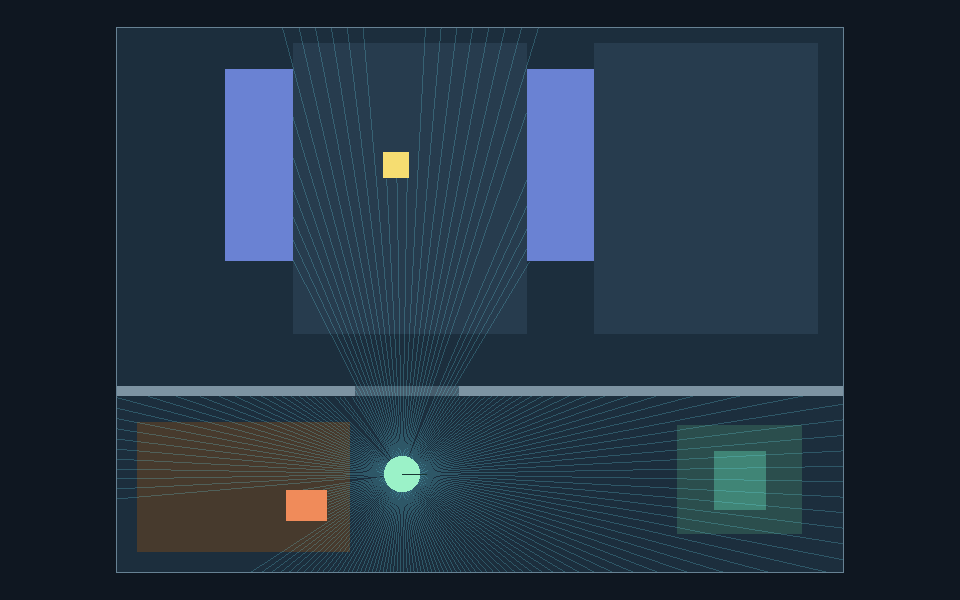

# Phase 4 simulated sensor verification

**Date** November 23, 2026

**Build and test revision** `917a879`

The Windows preview and headless replay share the simulated sensor rig. The Phase 4 gates passed locally. Hosted GitHub Actions remains open on the local branch.

## Verification

| Check | Observed result |
| --- | --- |
| `cmake --workflow --preset windows-debug` | Built both executables with MSVC 19.40.33811. **51/51** CTest tests passed. |
| `cmake --workflow --preset windows-release` | Built both Release executables. **51/51** CTest tests passed. |
| `cmake --workflow --preset linux-ci` | **50/50** tests passed on Ubuntu 24.04 under WSL2 with Clang 18.1.3, clang-tidy, ASan, UBSan and leak detection. |
| LiDAR geometry and noise | Fixed fixtures returned 2.3 m for the nearest divider and 4.5 m for the unobstructed rack. Corner contact, floor boundaries, range limits and missing returns passed. Noise repeated by seed. |
| Wheel odometry | Tests verified seeded scale bias and noise, different results for a different seed, uncertainty reporting, and a 60% forced-slip case that changed encoder distance while preserving physical motion. |
| RFID variability | Seeded trials tested 1,000 scans per condition. Read rates stayed within the expected ranges for direct, occluded and rotated-tag fixtures. Tests observed both misses and repeated EPCs, and checked dwell, antenna offset, direction and independent random streams. |
| Queue and timestamp contract | Tests verified sensor cadence, power loss, duplicate capture rejection, FIFO overflow accounting and deterministic reset. A 2,000-step small-backroom replay produced 2,000 wheel, 1,000 LiDAR and 1,000 RFID samples and retained 24 observations. |
| Headless compatibility | The existing drive probe retained its Phase 3 outputs. The 36-step sensor replay at warehouse tick 8 matched on Windows and Linux for all three layouts. The small-backroom replay retained a fictional RFID read and its first retained LiDAR sample had 174 returns. |
| Desktop preview | F4 toggled measured LiDAR independently of the developer truth overlay. The unmodified Release app exited cleanly on Escape. A separate Release probe captured 176 returns in the frame below. |
| Formatting and native analysis | Tracked C++ passed clang-format 18. MSVC project-code analysis passed on both executables. |
| Scenario compatibility | Draft 2020-12 validation accepted all existing fixtures and the optional orientation field at 359°. It rejected 360°. |

For the replay comparison, both executables ran `--warehouse NAME --tick 8 --sensor-steps 36` and emitted the same JSON after platform line endings were normalized. The small-backroom run reported 36 produced, 12 consumed and 24 dropped wheel samples. LiDAR and RFID each reported 18 produced, 6 consumed and 12 dropped.

The native analysis commands used a separate build directory:

```bat
cmake --preset windows-debug -B out/build/windows-phase-04-analysis "-DCMAKE_CXX_FLAGS=/DWIN32 /D_WINDOWS /EHsc /analyze /analyze:external- /external:anglebrackets /external:W0"
cmake --build out/build/windows-phase-04-analysis --target argus-desktop argus-headless --parallel 3
```

A temporary `glReadPixels` probe in a separate Release checkout captured the OpenGL client framebuffer. The screenshot contains measured ranges projected from the odometry estimate.



## Failures and limits

- The first grazing-ray test exposed rounding at a rectangle corner. A small intersection tolerance now preserves boundary contact across the verified compilers.
- MSVC analysis initially flagged more than 30 KiB of stack use in both entry points. The rig now owns heap-backed acquisition state and resets by reconstructing that state from its original seed and configuration. Native analysis passed on the revised build.
- The observations model planar geometry, bounded wheel error and simplified RF attenuation. Wheel uncertainty is an explicit budget. Signal strength is a simulated value for inspecting read behavior.
- Hosted GitHub Actions has yet to run for these local commits.
