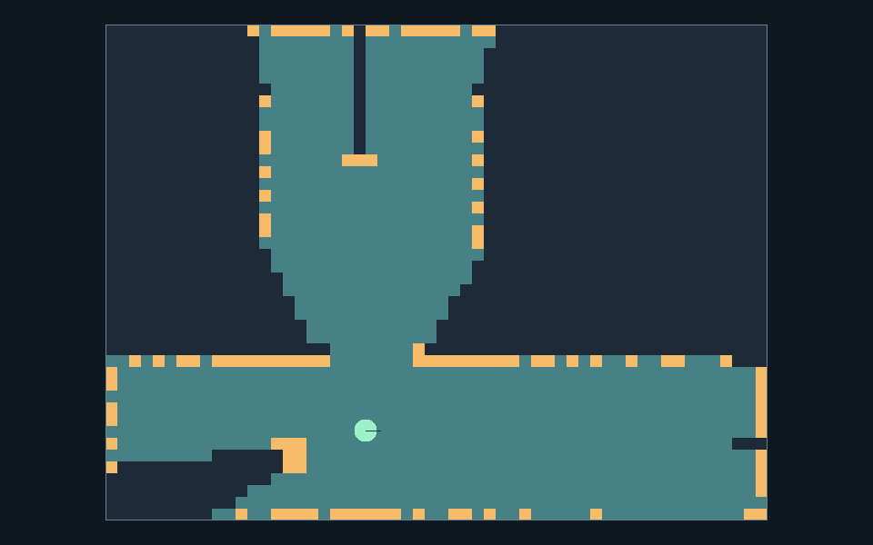

# Phase 5 mapping and localization verification

**Date** November 24, 2026

**Build and test revision** `9aed4cc`

The Phase 5 local gates passed. Both apps use observation-driven occupancy mapping and odometry. Hosted GitHub Actions remains unverified on the local branch.

## Verification

| Check | Observed result |
| --- | --- |
| `cmake --workflow --preset windows-debug` | **61/61** tests passed with MSVC 19.40.33811. |
| `cmake --workflow --preset windows-release` | **61/61** tests passed on the Release build. |
| `cmake --workflow --preset linux-ci` | **60/60** tests passed on Ubuntu 24.04 under WSL2 with Clang 18.1.3, clang-tidy, ASan, UBSan and leak detection. |
| Coordinate and occupancy checks | 2,000 sampled cell centers round-tripped. A known wall raster produced 8 occupied, 48 free and 25 unknown cells. Tests verified saturation, clipping, malformed input rejection and replay rejection. |
| Localization and recovery | Tests verified suspension at the uncertainty threshold, rejection of an invalid anchor, and the correct translated and rotated estimate following an explicit anchor. |
| Persistence | Exact evidence round-trip passed. Wrong versions, frames, scenario IDs and resolutions were rejected, along with checksum damage, truncation and trailing data. |
| Cross-platform replay | All three warehouse summaries matched at 80 steps and 300 mm resolution. A Windows snapshot loaded on Linux with 683 unknown, 829 free and 133 occupied cells. |
| Native preview | F5 entered the occupancy view while a developer overlay was active. The view hid that overlay, displayed all three cell classes, and returned to the prior view when toggled off. Both the normal Release app and the framebuffer probe exited cleanly. |
| Formatting and analysis | Tracked C++ passed clang-format 18. MSVC project-code analysis passed for the desktop, headless and evaluation targets. |

## Offline map quality

The evaluation executable ran a 120-step small-backroom survey at 250 mm resolution. It used the same noiseless LiDAR settings and drive commands in both cases. Windows and Linux reported the same values.

| Encoder profile | Classified coverage | Occupied IoU | Peak position error | Peak heading error |
| --- | ---: | ---: | ---: | ---: |
| Quantization only | 58.33% | 0.182464 | 0.773 mm | 0.005000 rad |
| Seeded drift and slip | 59.52% | 0.175234 | 7.658 mm | 0.024444 rad |

Coverage measures classification, independent of whether the assigned class is correct. IoU compares occupied cells across the whole map with static geometry and the perimeter raster. That comparison includes unobserved static obstacles and excludes the movement of actors. The values characterize this fixture and survey only.

Run the evaluator with `out/build/windows-release/argus-map-evaluation.exe` or `out/build/linux-ci/argus-map-evaluation`. Replay used `--warehouse NAME --map-steps 80 --cell-mm 300`. The cross-platform snapshot used the same parameters with `--export-map 80` on Windows and `--map-stdin --cell-mm 300` on Linux.

Native static analysis used a separate build directory:

```bat
cmake --preset windows-debug -B out/build/windows-phase-05-analysis "-DCMAKE_CXX_FLAGS=/DWIN32 /D_WINDOWS /EHsc /analyze /analyze:external- /external:anglebrackets /external:W0"
cmake --build out/build/windows-phase-05-analysis --target argus-desktop argus-headless argus-map-evaluation --parallel 3
```

A temporary `glReadPixels` probe in a separate Release checkout captured the OpenGL occupancy view. The captured pixels included the three cell classes and excluded the developer warehouse's rack color.



## Failures and limits

- The first MSVC build rejected an untyped zero used to clear 8-bit evidence. The final build uses the evidence type directly.
- The first evaluation asserted a 10 mm increase in position error. The observed increase was 6.885 mm. The final gate verifies a translation increase above 4 mm and a heading increase above 0.01 rad, both above the quantization-only reference for this run.
- Pose recovery uses an explicit independent anchor, and the snapshot stores evidence and frame metadata. It has no live localization state. The mapper's only link dependency is the core target, and truth evaluation is confined to the test-only executable.
- Hosted GitHub Actions has yet to run for these local commits.
