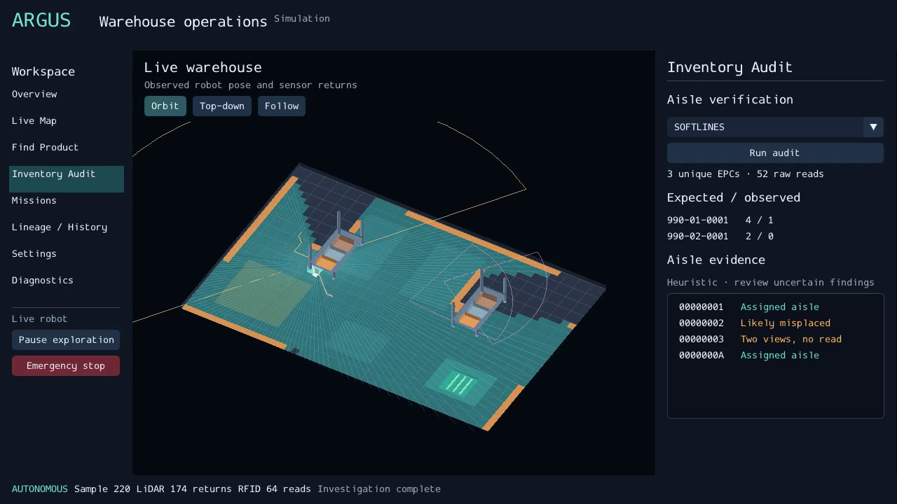

# Phase 10 native operations center verification

**Date** November 24, 2026

**Build and test revision** `810d1aa`

## Verification

| Check | Observed result |
| --- | --- |
| `cmake --workflow --preset windows-debug` | 97/97 tests passed with MSVC 19.40.33811. |
| `cmake --workflow --preset windows-release` | 97/97 tests passed. |
| `cmake --workflow --preset linux-ci` | 96/96 tests passed under Ubuntu WSL with Clang 18, clang-tidy, ASan, UBSan, and leak detection. |
| `ctest --test-dir out/build/windows-debug -V -R "^argus-desktop\.operations$"` | The opt-in native test passed after enabling `ARGUS_ENABLE_NATIVE_UI_TESTS`. It rendered 647 frames at 3.3714 ms p95. |
| `git ls-files -z -- '*.cpp' '*.hpp' '*.hpp.in' \| xargs -0 -r clang-format-18 --dry-run --Werror` | Passed for tracked C++ and header templates. |
| MSVC project-code analysis | The desktop and linked project targets built successfully with `/analyze`. |
| Dependency review | A depth-first traversal found 20 acyclic project targets. Dear ImGui 1.92.9 uses the pinned SDL3 and OpenGL2 backends on Windows. Headless targets have no SDL or ImGui link dependencies. |

The Windows workflows ran through the local Visual Studio wrapper. Linux used the pinned vcpkg checkout. The separate Windows analysis build used the following commands.

```bat
cmake --preset windows-debug -B out/build/windows-phase-10-analysis "-DCMAKE_CXX_FLAGS=/DWIN32 /D_WINDOWS /EHsc /analyze /analyze:external- /external:anglebrackets /external:W0"
cmake --build out/build/windows-phase-10-analysis --target argus-desktop --parallel 2
```

## Native acceptance evidence

- `out/build/windows-release/argus-desktop.exe --ui-smoke` completed the eight-panel tour. The robot's estimated pose moved more than 120 mm and produced LiDAR returns. The tour exercised catalog lookup, targeted investigation, aisle audit, scan-all, docking, manual inspection and review of the resulting state transitions.
- The native tour accepted a resize, rebuilt the OpenGL context and continued rendering. The command model tests verified focus disarming, repeat-key handling, emergency command precedence, and camera bounds. A Windows CLI test exercised the expected startup error with an unavailable SDL video driver.
- The Release smoke measured 633 frames with 12 visible rows from a synthetic 12,000-product list. The p95 active foreground loop was 0.381 ms, below the chosen 50 ms threshold on this host. The measurement includes input, simulator updates, UI work and the swap call, and excludes intentional pacing delay. Separate repository tests verified a product cursor crossing the 256-row page boundary.
- Normal rendering reads the authored fixture layout, estimated pose, map and sensors. Hidden EPC placement is absent from its interfaces. Unit tests verified that only an enabled Diagnostics panel can request the truth frame. The recording shows the labeled developer overlay in Diagnostics and its disappearance on return to Overview.
- The H.264 recording contains 578 native framebuffer frames at 1280 × 720 and 20 fps, for 28.90 seconds. It is stored locally at `out/evidence/phase-10-workflows.mp4`. The capture uses the application's framebuffer only. Reproduction commands are in the [operations center guide](../operations-center.md).



## Failures and limits

- The initial Windows build failed because include sorting placed the Windows GL header ahead of the Win32 declarations. The desktop now uses SDL's OpenGL header.
- An initial recording showed clipped finding labels. The final capture verified that the shortened labels are readable and the camera toolbar stays clear of overlay lines.
- The native Workbench uses the two configured aisles in the Phase 8 fixture. The foreground live renderer can display other supported warehouse layouts. The History panel shows the latest mission record.
- Closing the workbench during an active job can wait for that bounded background job to finish.
- Controlled context recreation was verified locally. Physical GPU removal and hosted GitHub Actions remain unverified.
