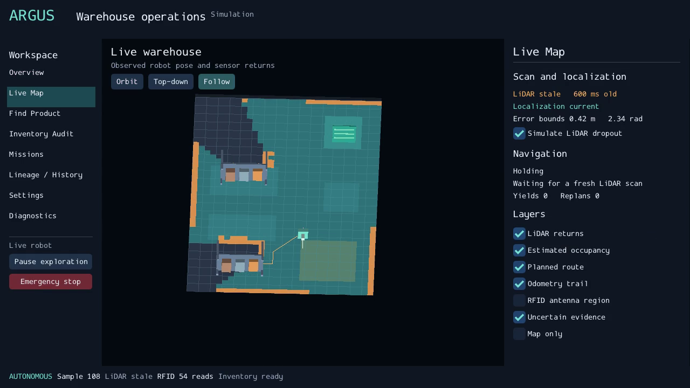

# Phase 13 live map verification

**Date** November 25, 2026

**Code under test** `c631282`

## Acceptance evidence

| Gate | Result |
| --- | --- |
| Fresh, stale, and unavailable LiDAR are distinguishable | The operations model tests cover missing and future scans, sensor power off, the 150 ms freshness boundary, the first expired tick, and saturation of the age calculation. The native recording shows expired rays disappearing while occupancy remains visible. |
| Localization communicates estimate quality | The operations model tests cover a missing estimate, a current estimate, stale and future estimates, and an unreliable estimate. The live panel shows the mapper's distance and heading error bounds and the scene marks the estimate quality with color. |
| Navigation explains holds and replans | The native tour injects a LiDAR dropout, observes a waiting navigator with zero commanded translation, and observes fresh scan recovery. The crossing-cart evaluation retains its simulated contact, yield, replan and docking assertions and verifies that the replan cause is recorded. |
| Operational data remains isolated from simulation truth | The operations model consumes the public navigation and mapping interfaces. The native tour still verifies the Diagnostics overlay boundary. The declared project link graph has 21 acyclic targets. |

## Verification commands

| Check | Command and result |
| --- | --- |
| Windows Debug | `cmake --workflow --preset windows-debug` passed 107/107 tests. |
| Windows Release | `cmake --workflow --preset windows-release` passed 107/107 tests. |
| Linux sanitizers and clang-tidy | `cmake --workflow --preset linux-ci` passed 106/106 tests with Clang 18.1.3, ASan and UBSan. |
| MSVC project-code analysis | `cmake --build out/build/windows-phase-11-analysis --target argus-headless argus-inventory argus-mission argus-desktop --parallel 2` passed with the existing `/analyze` configuration. |
| Formatting and whitespace | `git ls-files -z -- '*.cpp' '*.hpp' '*.hpp.in' \| xargs -0 -r clang-format-18 --dry-run --Werror` and `git diff --check` passed. |
| Native interaction | `out/build/windows-release/argus-desktop.exe --ui-smoke` passed the workflow, dropout, recovery, resize, context rebuild, and truth-overlay checks. It reported 742 frames and 0.444 ms p95 active frame time on the local Windows host. |

Run Windows commands in the x64 Visual Studio developer environment with the pinned vcpkg registry. Local Windows and Linux logs are retained under `out/evidence/phase-13`. The [recording recipe](../operations-center.md#local-verification-and-recording) produced `out/evidence/phase-13/live-map.mp4`. FFprobe reported 660 frames at 1280 × 720 and 20 fps, for 33 seconds of video.

## Behavior and limits

- Ages use the 50 ms simulation clock. The displayed scan comes from the mapper's accepted observations. The navigation decision reflects the control update that has already run, so the display can receive a newly aged or recovered sample before the next decision.
- A 1280 × 720 capture showed the initial dropout checkbox near the vertical scroll boundary while a hold reason was visible. The control moved into the scan status section and the map's layer controls were compacted.
- Localization uses the existing odometry estimate and its configured bounds. The simulated observation fault leaves wheel odometry and RFID running. Manual drive remains subject to the existing operator and simulation guards.
