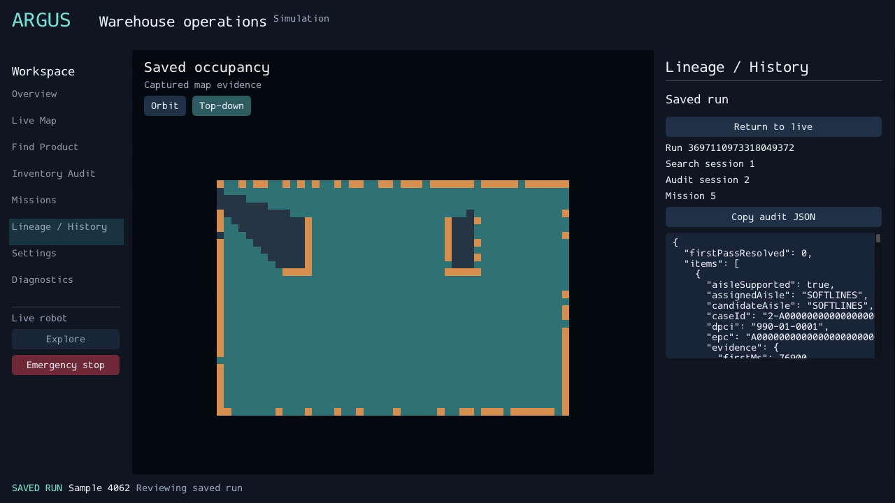

# Phase 14 continuous workflow verification

**Date** November 25, 2026

**Code under test** `386c70c`

## Acceptance evidence

| Gate | Result |
| --- | --- |
| One simulation from map to mission | The native tour retained one run ID and monotonically increasing simulation samples through exploration, search, audit, scanning, docking, and inspection. The audit contained actual RFID observations and the tour completed the mission workflows. |
| Observed worker progress | The native tour saw the worker own the run while the front end remained responsive. The single-slot snapshot contains estimates, observations and route data. The foreground retains exclusive access to truth diagnostics. |
| Save and reopen with durable provenance | A second desktop process opened the archived map and report while its live run had a different ID. An independent read-only SQLite check matched the report session, verified increasing search and audit start timestamps, checked the saved mission state, and verified the SHA-256 trailer in the version 2 map. |
| Records remain isolated and migrations preserve history | Unit tests migrate a version 1 mission store with existing work, reopen exact archived binary and JSON content, reject oversized replacement, and reject dispatch or recovery of a different mission. |
| Target dependency boundaries | Reviewed 21 explicitly declared CMake project targets. The link graph was acyclic. The desktop dependencies preserve the diagnostics-only truth boundary. |

## Commands and outcomes

| Command | Result |
| --- | --- |
| `cmake --workflow --preset windows-debug` | 110/110 tests passed. |
| `cmake --workflow --preset windows-release` | 110/110 tests passed. |
| `cmake --workflow --preset linux-ci` | 109/109 tests passed with Clang 18.1.3, clang-tidy, ASan and UBSan. |
| `cmake --build out/build/windows-phase-11-analysis --target argus-headless argus-inventory argus-mission argus-desktop --parallel 2` | Built successfully using the existing MSVC `/analyze` configuration. |
| `git ls-files -z -- '*.cpp' '*.hpp' '*.hpp.in' \| xargs -0 -r clang-format-18 --dry-run --Werror` and `git diff --check` | Formatting and whitespace checks passed. |

Use the Visual Studio x64 developer environment and pinned vcpkg registry for Windows builds. A disposable directory allowed the native probes to run in separate processes.

```powershell
$dir = New-Item -ItemType Directory -Path (Join-Path 'out/evidence/phase-14' ('desktop-' + [Guid]::NewGuid()))
out/build/windows-release/argus-desktop.exe --ui-smoke $dir.FullName
out/build/windows-release/argus-desktop.exe --ui-reopen $dir.FullName
```

The first process reported `continuousRun:true` and `savedRunReopened:true` over 795 rendered frames. The second reported `savedRunReopenedAfterRestart:true`. The read-only check observed 57 RFID reads and three distinct EPCs in the archived audit. Raw logs, the disposable run databases, and the independent verifier are in `out/evidence/phase-14`. Run `python3 out/evidence/phase-14/verify-archive.py` from the repository root to recheck the recorded data.

## Recording and limits

The [native recording recipe](../operations-center.md#local-verification-and-recording) produced `out/evidence/phase-14/shared-run.mp4`, including archived map and audit review. FFprobe reported 794 frames at 1280 × 720 and 20 fps, for 39.70 seconds. Motion is accelerated during routed work. The elapsed display counts simulated time.



- The first continuity run reached the existing localization budget before the scan mission could leave planning. The showcase now uses a simulated 0.1 mm encoder profile. The established uncertainty and stopping gates still govern movement.
- The most recent archive is a read-only capture. Reopening a database in a new process starts a separate live run and loads the saved evidence on request. The archive records the latest audit JSON and references earlier search and mission records.
- The routed workflow uses the bundled RFID audit stockroom. Other layouts continue to support driving and mapping. A desktop data directory is intended for one active operator instance.
